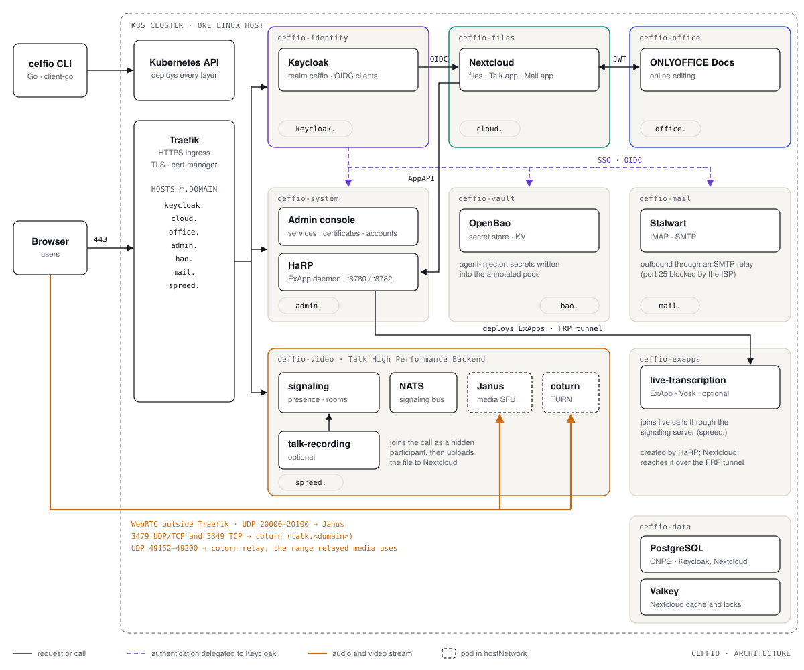

<p align="center">
  
</p>

<p align="center">
  <a href="https://github.com/ceffio-suite/ceffio/actions/workflows/ci.yml"></a>
  <a href="https://github.com/ceffio-suite/ceffio/releases/latest"></a>
  <a href="LICENSE"></a>
  <a href="https://github.com/ceffio-suite/ceffio/blob/main/go.mod"></a>
  <a href="https://github.com/ceffio-suite/ceffio/graphs/contributors"></a>
  <a href="https://goreportcard.com/report/github.com/ceffio-suite/ceffio"></a>
</p>

Your **sovereign collaborative suite**: open source, self-hosted.

Ceffio replaces Microsoft 365 / Teams for a company, an administration, or an
organisation — SSO identity, files, collaborative documents, mail and
videoconferencing — deployed on Kubernetes **with a single command**, with no
subscription and no dependency on a third-party service.

```bash
curl -fsSL https://raw.githubusercontent.com/ceffio-suite/ceffio/main/installer/install.sh \
  | sh -s -- install --domain example.com
```

Or build from sources:

```bash
git clone https://github.com/ceffio-suite/ceffio.git
cd ceffio && make build
sudo ./bin/ceffio install --domain example.com
```

> "Ceffio" is an anagram of "office".

## What Ceffio is (and is not)

Ceffio **is not a fork** of those applications. It is a **unified integration
layer** — installation, configuration, SSO, provisioning, lifecycle, security,
monitoring, backup/restore, upgrades, air-gap — built around proven open
source projects:

| Domain       | Component                          |
|--------------|------------------------------------|
| Identity/SSO | Keycloak                           |
| Files        | Nextcloud                          |
| Chat         | Nextcloud Talk                     |
| Video        | Nextcloud Talk + Janus (HPB)       |
| Recording    | Nextcloud Talk recording backend   |
| Transcription| Live transcription (ExApp via HaRP) |
| Office       | ONLYOFFICE                         |
| Mail         | Stalwart                           |
| Data         | PostgreSQL (CloudNativePG) + Valkey |
| Secrets      | OpenBao                            |
| Ingress/TLS  | Traefik + cert-manager             |
| Console      | Ceffio administration console      |

The product promise is that all of this is **self-supporting in one command**:
SSO works across every app from the start, credentials are generated and
sealed in the vault — never asked for in a prompt, never left in a file.

### Why Talk instead of Element + Jitsi

An earlier version of Ceffio assembled **Matrix (Synapse + Element)** for chat
and **Jitsi** for video. That stack was **removed**, for three reasons:

1. **Two authentication systems to synchronise.** Matrix and Jitsi each have
   their own; they had to be wired to Keycloak through dedicated bridges
   (OpenID tokens, a user-verification service). Every bridge is a failure
   source, and one misconfigured authentication loop is enough to make video
   unusable.
2. **A double operational surface** for the administrator: two stacks, two
   lifecycles, two backup sets.
3. **Talk is native to Nextcloud**: its authentication is Nextcloud's, itself
   wired to Keycloak. There is no bridge left to maintain, and chat and video
   live in the same tool as the files.

That choice is what makes the product genuinely "self-supporting in one
command": fewer moving parts, therefore fewer things to break.

## Architecture

A Go CLI installs K3s on a Linux host, then deploys and configures each
building block in its own namespace, directly through the Kubernetes API
(client-go). There is no Operator: the CLI is the only control point, and
every deployment is idempotent.

<p align="center">
  
</p>

Three things to read on this diagram:

- **All web traffic enters through Traefik**, which serves each application
  under its own subdomain (`cloud.`, `office.`, `keycloak.`, `talk.`,
  `admin.`, `bao.`, `mail.`) with certificates managed by cert-manager.
- **Keycloak is the only source of identity.** Nextcloud, the console,
  OpenBao and Stalwart delegate authentication to it (OIDC).
- **Media bypasses Traefik.** Janus and coturn run in `hostNetwork` and
  receive audio and video directly on the host ports (see
  "Media and firewall").

Each application's secrets (database passwords, the ONLYOFFICE JWT token,
the signaling secrets) are stored in OpenBao and written into the pods by
its agent-injector: nothing is in clear text in Git.

| Namespace | Contents |
|---|---|
| `ceffio-identity` | Keycloak |
| `ceffio-files` | Nextcloud (files, Talk, Mail) |
| `ceffio-office` | ONLYOFFICE Docs |
| `ceffio-video` | Talk HPB: signaling, NATS, Janus, coturn, recording |
| `ceffio-exapps` | ExApps: HaRP deploy daemon, live transcription |
| `ceffio-vault` | OpenBao, agent-injector |
| `ceffio-mail` | Stalwart |
| `ceffio-data` | PostgreSQL (CloudNativePG), Valkey |
| `ceffio-system` | Administration console (deployment `ceffio-admin`) |

## The layers

Each layer is a Go package that deploys and configures one part of the stack.
This decomposition is what makes upgrading possible: every layer knows what it
runs, so before and after can be compared.

| Layer | Package | Contents |
|---|---|---|
| Platform | `internal/platform` | K3s, Ingress, cert-manager |
| Data | `internal/data` | CloudNativePG, PostgreSQL, Valkey |
| Identity | `internal/identity` | Keycloak, realm, OIDC clients |
| Files | `internal/files` | Nextcloud |
| Office | `internal/office` | ONLYOFFICE + Nextcloud connector |
| Mail | `internal/mail` | Stalwart |
| **Talk + HPB** | `internal/talk` | Janus (SFU), signaling, coturn, NATS |
| Secrets | `internal/vault` | OpenBao + injector |
| Console | `internal/console` | Administration console |
| Ingress | `internal/ingress` | Routes and certificates |

### Talk's High Performance Backend

Talk works alone up to roughly 4–6 participants, in direct
browser-to-browser connections. Beyond that you need a **SFU**: a server that
receives each stream once and redistributes it to everyone. That is this
fourth component's role.

    Talk (Nextcloud app)   interface, chat, room management
    signaling              who is present, who joins what
    Janus                  media transport (the SFU)
    NATS                   coordination between signaling instances
    coturn                 TURN/STUN relay

Two design points that required correction under real conditions:

- **`hostNetwork` on Janus and coturn.** A Kubernetes `NodePort` Service can
  expose only **one** port, never a range — while WebRTC media needs a whole
  open range end to end. Without `hostNetwork`, everything reports "Running"
  and nothing flows.
- **The public address must be announced.** Behind NAT, a Janus that announces
  its private addresses in the ICE candidates produces a black screen: the
  browser cannot reach it. The public address is **discovered automatically**,
  never supplied at deployment: Janus and the TURN relay obtain it themselves
  at startup via STUN, and the signaling server announces a public name
  (`talk.<domain>`), which survives an address change — where a hard-coded
  value would silently stop working.

## Modules

Every feature of the suite — the ten core layers and the optional add-ons —
is a **module**: a Go package implementing a single interface (`Info`,
`Install`, `State`, `Uninstall`) and registering itself in a global registry.
The registry is the catalog every frontend reads: `ceffio install
--with/--without`, `ceffio module list|install|remove|status`, the console's
Modules page, the status and doctor layer lists, and the console's RBAC grant
are all generated from it — no feature list is hardcoded anywhere. Adding a
feature means adding a module; see
[`docs/adding-a-module.md`](docs/adding-a-module.md).

**Core modules** are the product: `platform`, `data`, `vault`, `identity`,
`files`, `office`, `talk`, `ingress`, `mail`, `console`. `ceffio install`
deploys them in its own sequence, and they are removed only with the cluster
(`ceffio uninstall`) — `ceffio module remove` refuses them.

**Optional modules** are chosen by the operator, at install time
(`--with`/`--without`) or afterwards (`ceffio module install <id>`, or the
console's Modules page):

| ID | Role | Resources | Requires | Installed by default |
|---|---|---|---|---|
| `recording` | Records Talk calls: a hidden participant joins the room, renders it and uploads the result to Nextcloud | — (workload limited to 2 GiB RAM, no model download) | — | **yes** (`--without recording` to skip) |
| `exapps-daemon` | HaRP runs the containers Nextcloud asks for, speaking the Kubernetes API directly — prerequisite of every external application | — | — | no |
| `live-transcription` | Transcribes speech live during a Talk call, on this server, with open source speech models; nothing is sent to a third party | ~9 GB disk, ~16 GB RAM | `exapps-daemon` (installed automatically with it) | no |

Declared dependencies are expanded by the registry: asking for
`live-transcription` installs `exapps-daemon` first, and `ceffio module
remove exapps-daemon` is refused while an installed module requires it.
Recording functionally needs the Talk layer (its install reads the signaling
secret from the vault and says so if Talk is absent), but as a `Default`
module it ships with the standard install, where Talk is always present.

## Installation

The deployment is **idempotent**: running it again breaks nothing, it updates
what needs updating. That is what makes a reinstall after an incident safe.

Prerequisites:

- A Linux host with root access (Ceffio installs K3s itself)
- Go 1.27+ only when building from sources
- Media ports reachable from the Internet **and** forwarded: see "Media and
  firewall" below

## The CLI

| Command | Role |
|---|---|
| `ceffio install` | deploy the full stack — optional modules via `--with`/`--without` (catalog generated from the registry) |
| `ceffio status` | state of the deployed services |
| `ceffio doctor` | diagnostics (prerequisites, coherence, health) |
| `ceffio module list` | every module of the registry with its state |
| `ceffio module install <id>` | install an optional module and its dependencies |
| `ceffio module remove <id>` | remove an optional module (`--yes` to skip confirmation) |
| `ceffio module status <id>` | detailed state of a module (status, detail, blocked) |
| `ceffio backup` | backup (databases, secrets, volumes) |
| `ceffio restore` | restore from a backup |
| `ceffio upgrade --plan` | show what would change, before changing it |
| `ceffio users` | provision accounts (Keycloak + applications) |
| `ceffio console` | administration console |
| `ceffio theme` | reapply the Ceffio theme to Nextcloud |
| `ceffio vault` | the secrets vault (OpenBao) |
| `ceffio dns` | check DNS configuration (A, AAAA, MX, SPF, DKIM, DMARC, PTR) |
| `ceffio expose` | publish the suite behind the firewall |
| `ceffio uninstall` | uninstall and destroy the cluster |

## Secrets: the vault is the only source

All application credentials (database passwords, admin accounts, OIDC client
secrets, JWT signing keys) live in **OpenBao**, deployed by `ceffio install`
itself. Pods read their secrets **at startup** through the OpenBao agent
injector; no application credential exists as a Kubernetes Secret anymore.
Rotation happens in one place, and the administration console reads and
rotates through the same vault. Human logins go through OIDC (Keycloak);
services authenticate to the vault through Kubernetes auth — two doors, never
a shared token in a file.

## The administration console

A web interface for daily operations: service states, certificates with their
expiry dates, SSO account management. It reads the cluster's real state — it
does not guess it. See [`internal/console/README.md`](internal/console/README.md)
and the "Console image" section below.

## Console image

The console runs as a container image, built and published **by this
repository** (the `release.yml` workflow, job `console-image`): every release
tag `vX.Y.Z` publishes `ghcr.io/ceffio-suite/ceffio:X.Y.Z` for
`linux/amd64` and `linux/arm64`. `latest` follows stable versions only —
never an `-rc` candidate. The image embeds the **exact binaries of the
release** (byte for byte, verified against `checksums.txt`), never a separate
recompilation.

The image is named `ceffio`, not `ceffio-console`, and that is deliberate: a
GHCR package belongs to the repository that first published it, and a workflow
in another repository cannot push to it — the attempt is refused with
`denied: permission_denied: write_package` even with `packages: write`
granted. The name `ceffio-console` was created by the former separate
repository and stayed with it; `ceffio` is owned by this one. The former
repository
[`ceffio-suite/ceffio-console`](https://github.com/ceffio-suite/ceffio-console)
is archived.

The image is `FROM scratch`: no shell, no package manager — the static binary
plus the certificate authorities. It is normally deployed **inside the
cluster** by `ceffio install` (phase 11), which pulls it from GHCR. To run it
manually (for example against a cluster reachable through your kubeconfig):

```bash
docker run --rm -p 8088:8088 \
  -v ~/.kube/config:/kubeconfig:ro -e KUBECONFIG=/kubeconfig \
  ghcr.io/ceffio-suite/ceffio:X.Y.Z \
  console --domain example.com --addr :8088
```

The entrypoint is the `ceffio` binary; the arguments above replace the default
`CMD` (`console --addr :8088`) to pass the required `--domain`. The
administration key can be supplied with `--key` or the `CEFFIO_KEY`
environment variable (generated and printed at startup otherwise); inside the
cluster it comes from the OpenBao vault via the agent injector.

### Permissions required in the cluster

Stated plainly, because an earlier document claimed the console only reads —
that was false. The console's `ServiceAccount` (`ceffio-admin`, created by
`ceffio install`) holds, per the RBAC deployed by
[`internal/console/deploy.go`](internal/console/deploy.go):

- **cluster-wide reads**: pods, namespaces, deployments, ingresses,
  cert-manager certificates — what the dashboard and the certificates page
  show;
- **writes inside the `ceffio-*` platform namespaces only** (never
  `kube-system`, never `cert-manager`, never `longhorn-system`): pods,
  services, configmaps, secrets, PVCs, service accounts, deployments,
  statefulsets, ingresses, certificates, roles/rolebindings, CloudNativePG
  clusters — this is what installing HaRP and the live-transcription ExApp
  from the console requires;
- **`pods/exec` limited to `ceffio-files`** (Role `ceffio-console-occ`): to
  run `occ` in the Nextcloud pod for the system settings the OCS API does not
  expose (SMTP, local account password). Keycloak, for its part, is driven
  through its Admin REST API, not through exec;
- **no right over cluster roles and no `delete` on namespaces**: RBAC is
  granted by the installer, never by the console itself.

In short: the console **does write to the cluster** — within the platform
namespaces, with the perimeter above — while full (re)deployment remains the
CLI's business (`ceffio install`).

## Media and firewall

This is the part most often gotten wrong, because it depends on the network
topology rather than on the code. Four families of ports must be reachable
**from the Internet**:

| Ports | Protocol | Role |
|---|---|---|
| `20000-20100` | UDP | Janus media (the video itself) |
| `3479` | UDP + TCP | TURN relay — essential on restrictive networks |
| `5349` | TCP | TURN secured (fallback when UDP is blocked) |
| `49152-49200` | UDP | coturn relay ports — the range the relayed media actually uses |

All four are verified reachable on a live deployment: `3479` answers a STUN
Binding Request from the Internet, `5349` performs a TLS handshake and serves
the `talk.<domain>` certificate, and a TURN allocation made **from outside**
returns a public relay address inside `49152-49200`.

The relay range is the one that is easy to forget, and forgetting it produces
a deceptive failure: the allocation succeeds (it goes over `3479`), the server
believes the relay is up, and **no media ever passes** — because the media is
supposed to flow on the range. A browser that cannot reach it falls back to
direct candidates, and on a restrictive network there are none, so the call
fails with "a TURN server is probably required" while the TURN server is, in
fact, perfectly healthy.

These ranges are **specific to Ceffio**: they do not overlap another LiveKit
or Janus instance on the same network, so a failure of one does not affect
the other.

Three verified pitfalls:

- **On a firewall that handles ranges, leave the internal port empty.** pf
  (OpenBSD/OPNsense) reads `rdr-to IP port N` as "map everything onto N":
  filling that field with a single port silently collapses the whole range
  onto it, while still reporting "saved".
- **Forward from the right device.** If the VM sits behind a router which in
  turn sits behind the ISP box, rules placed on the router cannot work: they
  belong on the box. Always test from the Internet, never from the local
  network — an internal test proves nothing.
- **A range must be forwarded 1:1.** Each port of `49152-49200` must reach the
  **same** port on the host. coturn announces the relay port it allocated and
  the peer connects back to exactly that number; a translating NAT breaks the
  return path even though the allocation looked fine.

The check that settles all of this, run against the **public** address:

```bash
turnutils_uclient -u "<username>" -w "<credential>" -y \
    -e <public-ip> -p 3479 talk.<domain>
```

A healthy server prints a **public** relay address with a port inside the
range, and loses no packet:

```
INFO IPv4. Received relay addr: 82.64.251.96:49198
INFO Total lost packets 0 (0.000000%)
```

A **private** relay address means `--external-ip` did not take effect: the
browser then receives a candidate it cannot reach, which is the same failure
by another route.

## TLS certificates: HTTP-01 or DNS-01

Ceffio obtains its certificates from Let's Encrypt through cert-manager, with
**two** ways of proving the domain is yours. The challenge is a setting, not a
build-time choice.

| | HTTP-01 (default) | DNS-01 |
|---|---|---|
| Proof | a token served on port 80 of each hostname | a TXT record in your DNS zone |
| Credential | none | a DNS provider API token, held in OpenBao |
| Port 80 required | yes, for `.well-known/acme-challenge` | no |
| **Wildcard `*.domain`** | **impossible** | yes |
| Certificates needed | one per hostname | **one for the whole domain** |

### Why the default is HTTP-01

Nothing to configure, no credential to store or rotate. An installation that
sets nothing behaves exactly as before this setting existed.

Its limit is structural, not a matter of tuning: **the ACME protocol gives the
authority no way of validating a wildcard over HTTP**, because a wildcard names
hosts that do not exist yet. Nine hostnames therefore mean nine certificates,
each renewed every sixty days against Let's Encrypt's weekly quota — and a
hostname with no service listening on port 80 (a name served only over a
wildcard, for example) can never be validated at all.

### Why you would switch to DNS-01

**One issuance instead of nine.** `ceffio.org` and `*.ceffio.org` arrive in a
single certificate. A hostname added later is served immediately, with no new
issuance and no quota consumed. The port 80 exemption disappears from the
Traefik middlewares, since nothing is fetched there anymore.

### How to enable it

```bash
export CEFFIO_ACME_CHALLENGE=dns01
export CEFFIO_DNS_PROVIDER=cloudflare   # or scaleway, ovh, gandi, hetzner, rfc2136…
export CEFFIO_DNS_ZONE=example.com      # defaults to the installation domain
ceffio install --domain example.com
```

The provider credential is then entered **in the admin console, TLS page** — it
goes to OpenBao, and the DNS solver reads it through the injector. Nothing has
to be copied into the cluster by hand, and the console never reads the value
back.

A missing or contradictory setting stops the installation with its own name in
the message. A provider set while the challenge is still `http01` is refused
rather than ignored: a configuration that does not do what it says is worse
than one that fails.

### The providers, and why the list is open

cert-manager ships eight in-tree solvers. Everything else goes through a webhook
solver that Ceffio deploys — built on [libdns](https://github.com/libdns/libdns),
the interface extracted from Caddy, whose compatibility check last reported 68
supported providers. **The provider name travels as a value in the
ClusterIssuer**, so adding a host is a configuration change, never a code
change and never a new release.

Three paths cover every situation, including "no DNS provider account":

| Your situation | Solver | Notes |
|---|---|---|
| Cloudflare, Route 53, Azure, Google… | in-tree | nothing extra deployed |
| Scaleway, OVH, Gandi, Hetzner, … | libdns webhook | one component, provider by name |
| Your own DNS (BIND, Knot, PowerDNS, Technitium) | `rfc2136` | standard dynamic updates, TSIG key |
| No rights on the main zone | `acmedns` | answers only for `_acme-challenge`, delegated by CNAME |

### Two pitfalls worth knowing before you debug

- **The self-check must see the Internet.** cert-manager verifies the challenge
  record by resolving through `/etc/resolv.conf`. On a resolver that answers the
  public zone internally, it waits for a propagation it can never observe and
  the certificate simply never arrives — with nothing in its status pointing at
  DNS. Ceffio installs cert-manager with
  `--dns01-recursive-nameservers-only --dns01-recursive-nameservers=8.8.8.8:53,1.1.1.1:53`
  so the check sees what Let's Encrypt sees.
- **Never `cnameStrategy: Follow` by accident.** It makes cert-manager obey any
  CNAME found at `_acme-challenge.<domain>` — including one synthesized by a
  wildcard record. The challenge record is then written in the wrong zone, and
  the refusal ("not permitted in zone") never explains why.

## Releases

Every release is a Git tag plus a GitHub Release carrying the linux/amd64 and
linux/arm64 binaries and their SHA-256 checksums. The `release.yml` workflow
builds and publishes them — but only after the CI of the tagged commit is
green. Grab the current one from the
[releases page](https://github.com/ceffio-suite/ceffio/releases/latest) and
verify before running:

```bash
sha256sum -c --ignore-missing checksums.txt
```

## Development

Development happens on `develop`; features arrive by pull request, and `main`
only ever holds a releasable state. See [CONTRIBUTING.md](CONTRIBUTING.md)
for the full GitFlow, the release process, and the engineering rules this
codebase follows.

```bash
make build            # build ./bin/ceffio
./bin/ceffio --help   # list of commands
make test             # tests
make vet              # static analysis
gofmt -l .            # must print nothing
```

## Status

The product is **deployed and working**: Nextcloud, ONLYOFFICE, Keycloak,
Stalwart (mail), Talk with its High Performance Backend (audio and video
calls validated between two participants), the administration console,
backup/restore, and the OpenBao vault.

Open points, stated plainly:

- **Mail sending depends on your provider.** Port 25 outbound is blocked by
  many ISPs; the suite supports a smart-host relay, but publishing MX, SPF,
  DKIM and DMARC correctly is an operator task (`ceffio dns` checks it).
- **The bootstrap script works against published releases.** Until the first
  tag is cut, installation means building from sources — the commands above.

## License

Ceffio is distributed under the **GNU Affero General Public License v3.0 or
later** (`AGPL-3.0-or-later`). See [LICENSE](LICENSE).

Copyright © MANDEM.

Ceffio deploys third-party software that keeps its own license (Apache-2.0,
AGPL-3.0, GPL-3.0, MPL-2.0, BSD…). See
[THIRD_PARTY_LICENSES.md](THIRD_PARTY_LICENSES.md).

"Ceffio" and its logo are trademarks of MANDEM; the code license grants no
right over these trademarks.
